<a href="https://ng-tools.fr">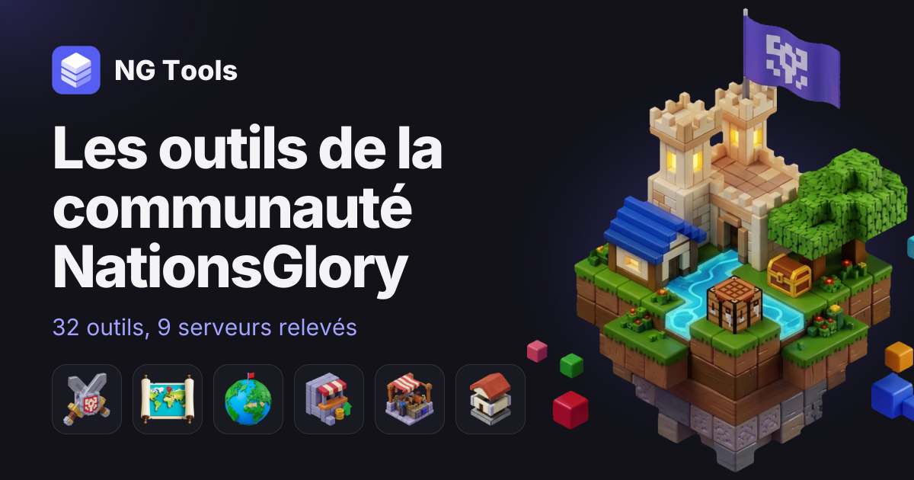</a>

  
  
  
  

Les outils de la communauté **NationsGlory** : guerres, pays, joueurs, économie et build, relevés en continu sur les 9 serveurs, plus un serveur Build pour préparer ses constructions.

### ⚔️ Guerre

<table><tr>
<td align="center" width="110"><a href="https://ng-tools.fr/guerres">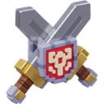 <b>Guerres</b></a></td>
<td align="center" width="110"><a href="https://ng-tools.fr/carte">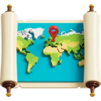 <b>Carte</b></a></td>
<td align="center" width="110"><a href="https://ng-tools.fr/palmares"> <b>Palmarès</b></a></td>
<td align="center" width="110"><a href="https://ng-tools.fr/guerriers">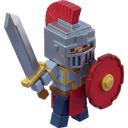 <b>Guerriers</b></a></td>
<td align="center" width="110"><a href="https://ng-tools.fr/pillage">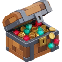 <b>Pillage</b></a></td>
</tr></table>

### 🌍 Monde

<table><tr>
<td align="center" width="110"><a href="https://ng-tools.fr/pays">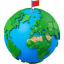 <b>Pays</b></a></td>
<td align="center" width="110"><a href="https://ng-tools.fr/notations">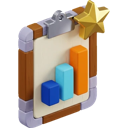 <b>Notations</b></a></td>
<td align="center" width="110"><a href="https://ng-tools.fr/alliances">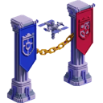 <b>Alliances</b></a></td>
<td align="center" width="110"><a href="https://ng-tools.fr/meteorites">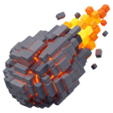 <b>Météorites</b></a></td>
<td align="center" width="110"><a href="https://ng-tools.fr/alertes">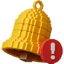 <b>Alertes</b></a></td>
</tr></table>

### 👥 Joueurs

<table><tr>
<td align="center" width="110"><a href="https://ng-tools.fr/joueurs">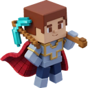 <b>Joueurs</b></a></td>
<td align="center" width="110"><a href="https://ng-tools.fr/mercato">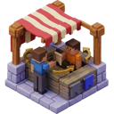 <b>Mercato</b></a></td>
<td align="center" width="110"><a href="https://ng-tools.fr/recrutement"> <b>Recrutement</b></a></td>
<td align="center" width="110"><a href="https://ng-tools.fr/youtubeurs"> <b>Youtubeurs</b></a></td>
</tr></table>

### 💰 Économie

<table><tr>
<td align="center" width="110"><a href="https://ng-tools.fr/hdv">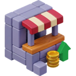 <b>HDV</b></a></td>
<td align="center" width="110"><a href="https://ng-tools.fr/cereales">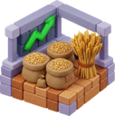 <b>Céréales</b></a></td>
<td align="center" width="110"><a href="https://ng-tools.fr/encheres">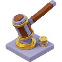 <b>Enchères</b></a></td>
<td align="center" width="110"><a href="https://ng-tools.fr/loteries">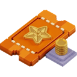 <b>Loteries</b></a></td>
<td align="center" width="110"><a href="https://ng-tools.fr/entreprises">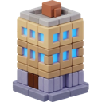 <b>Entreprises</b></a></td>
<td align="center" width="110"><a href="https://ng-tools.fr/catalogue">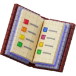 <b>Catalogue</b></a></td>
<td align="center" width="110"><a href="https://ng-tools.fr/crafts">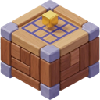 <b>Crafts</b></a></td>
</tr></table>

### 🧱 Build

<table><tr>
<td align="center" width="110"><a href="https://ng-tools.fr/schematiques">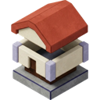 <b>Schématiques</b></a></td>
<td align="center" width="110"><a href="https://ng-tools.fr/convertisseur-3d">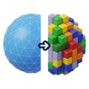 <b>Convertisseur 3D</b></a></td>
<td align="center" width="110"><a href="https://ng-tools.fr/palettes">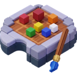 <b>Palettes</b></a></td>
<td align="center" width="110"><a href="https://ng-tools.fr/packs">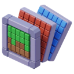 <b>Packs de textures</b></a></td>
<td align="center" width="110"><a href="https://ng-tools.fr/build">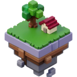 <b>Serveur Build</b></a></td>
<td align="center" width="110"><a href="https://ng-tools.fr/build/depot">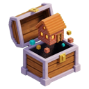 <b>Dépôt de schematics</b></a></td>
<td align="center" width="110"><a href="https://ng-tools.fr/build/carte">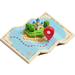 <b>Carte de mon île</b></a></td>
</tr></table>

### 🤖 NG Tools dans ton IA

<a href="https://ng-tools.fr/mcp">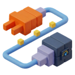</a>

Branche les données de NG Tools sur Claude, ChatGPT ou n'importe quel assistant compatible MCP : [ng-tools.fr/mcp](https://ng-tools.fr/mcp).
 

---
NG Tools est un projet de fan, non affilié à NationsGlory, Recube, Mojang ni Microsoft.
